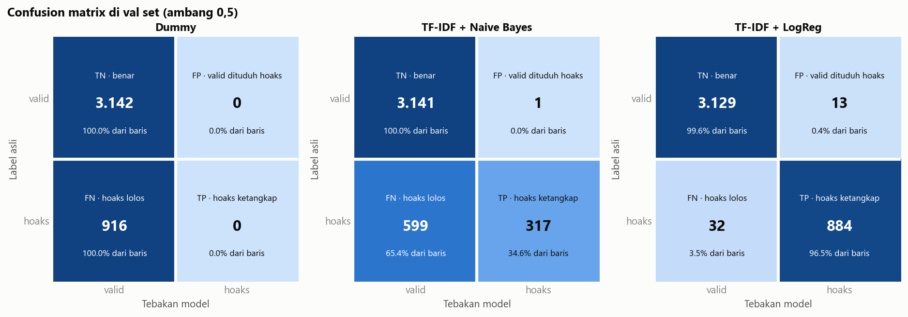
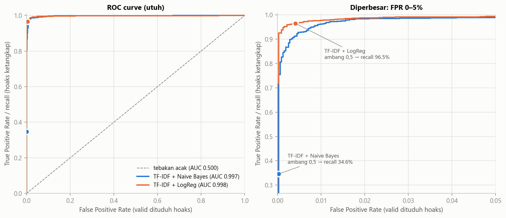

# Fake News Detection v1

Klasifikasi berita **hoaks vs valid** pakai ML klasik (TF-IDF + Logistic Regression, dengan Naive Bayes sebagai pembanding).

> 🚧 Masih dikerjakan. README lengkap diisi di M10.

## Dataset

- **Sumber:** Kaggle, _TODO: link halaman dataset_
- **Lisensi:** _TODO: cek di halaman Kaggle_
- **Bahasa:** Indonesia
- **Isi:** 4 file hasil scraping (folder `Cleaned/`)

| Sumber | Label | Kolom teks yang dipakai | Jumlah (setelah dibersihkan) |
|---|---|---|---|
| CNN Indonesia | valid (0) | `FullText` | 9.630 |
| Kompas | valid (0) | `FullText` | 4.723 |
| Tempo | valid (0) | `FullText` | 6.592 |
| Turnbackhoax | hoaks (1) | `Narasi` | 6.121 |
| **Total** | | | **27.066** (77,4% valid / 22,6% hoaks) |

**Pembersihan yang dilakukan** (detail di `notebooks/01_eda.ipynb`):
- Hoaks pakai kolom `Narasi` (isi hoaks yang beredar), bukan `FullText` (artikel bantahan pemeriksa fakta). `Narasi` dipotong di pembatas `===` / `Penjelasan:` supaya penjelasan pemeriksa fakta tidak ikut.
- Hanya artikel Turnbackhoax berjudul `[SALAH]`, `[HOAX]`, `[DISINFORMASI]`, dsb. Yang berjudul `[BENAR]`, `[KLARIFIKASI]`, `[BERITA]`, dll. dibuang (1.158 baris) karena bukan hoaks.
- Teks kosong / kurang dari 3 kata dibuang.

**Keterbatasan:** label ditentukan dari **sumber** (portal berita = valid, unggahan medsos yang dicek Turnbackhoax = hoaks). Akibatnya ada banyak "jejak sumber": dateline media, sisa scraping, perbedaan panjang teks (median 312 vs 28 kata), dan gaya bahasa formal vs informal. Lihat bagian Audit kebocoran (M7).

## Evaluasi di val set (M5)





| Model | Precision hoaks | Recall hoaks | F1 hoaks | ROC-AUC | FP (valid dituduh hoaks) | FN (hoaks lolos) |
|---|---|---|---|---|---|---|
| Dummy | 0,000 | 0,000 | 0,000 | 0,500 | 0 | 916 |
| TF-IDF + Naive Bayes | 0,997 | 0,346 | 0,514 | 0,997 | 1 | 599 |
| TF-IDF + LogReg | 0,986 | 0,965 | 0,975 | 0,998 | 13 | 32 |

Val set: 3.142 valid, 916 hoaks. Ambang keputusan 0,5.

**Catatan Naive Bayes:** ROC-AUC-nya hampir sama dengan LogReg (0,997), artinya NB sebenarnya bisa *mengurutkan* hoaks di atas valid dengan baik. Tapi peluang yang dia keluarkan terlalu kecil, jadi di ambang 0,5 dua pertiga hoaks lolos. Masalahnya ada di **ambang/kalibrasi**, bukan kemampuan membedakan. Ini akan diuji di M6 (nilai `alpha` lebih kecil).

### Mana yang lebih berbahaya: hoaks lolos (FN) atau berita asli dituduh hoaks (FP)?

Jawabannya tergantung **model ini dipakai untuk apa**.

| Skenario pemakaian | Kesalahan yang lebih mahal | Metrik prioritas |
|---|---|---|
| **A. Alat bantu penyaring untuk pemeriksa fakta manusia**: model menandai konten yang *perlu dicek*, keputusan akhir tetap di manusia | **FN**. Hoaks yang lolos nggak akan pernah dicek dan terus menyebar. FP cuma bikin pemeriksa buang beberapa menit | **Recall hoaks**, dengan syarat precision tetap wajar |
| **B. Pelabelan otomatis ke publik**: model langsung memberi cap "HOAKS" tanpa dicek manusia | **FP**. Berita asli yang dicap hoaks merusak kepercayaan ke media dan ke alat ini sendiri, dan bisa jadi bentuk sensor | **Precision hoaks** |

**Keputusan untuk project ini: skenario A, prioritas recall hoaks** (dengan F1 sebagai pembanding keseluruhan). Alasannya:
1. Model ini mendeteksi **gaya bahasa**, bukan **kebenaran fakta** (lihat Keterbatasan dan M7). Model seperti ini **tidak layak** memberi cap otomatis ke publik, jadi skenario B memang bukan pilihan.
2. Di skenario A, satu hoaks yang lolos (FN) bisa menyebar ke ribuan orang, sedangkan satu FP cuma menambah satu item di antrean pemeriksa.

Artinya, waktu memilih model di M6–M8, kita lihat **recall hoaks** dulu, dan precision dijaga jangan sampai anjlok (patokan kasar: ≥ 0,90). Untuk LogReg saat ini: dari 916 hoaks di val, **32 lolos** (recall 96,5%), dan **13 berita asli** ikut tertandai (precision 98,6%).

> ⚠️ Angka setinggi ini **belum tentu** berarti model paham hoaks. Lihat temuan EDA soal jejak sumber; ini diaudit di M7.

## Cara menjalankan

```bash
python -m venv .venv
.venv\Scripts\activate        # Windows
pip install -r requirements.txt
```
