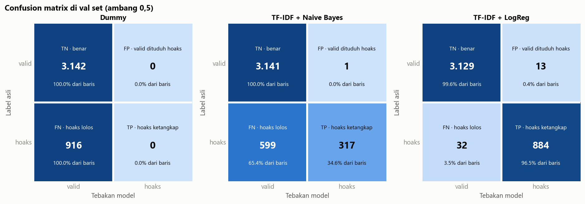
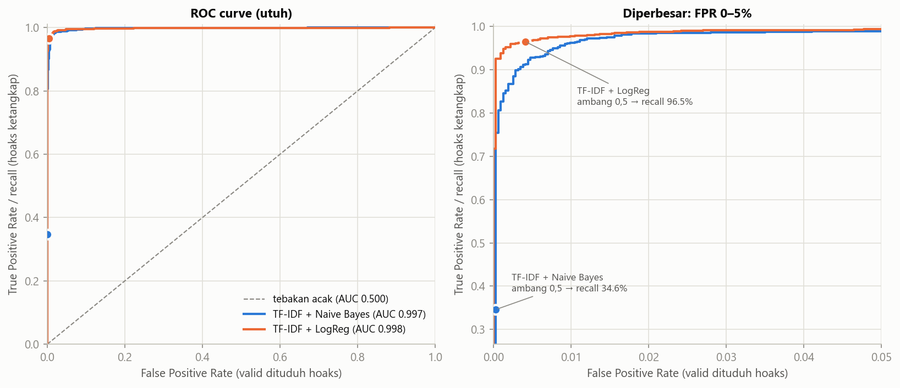
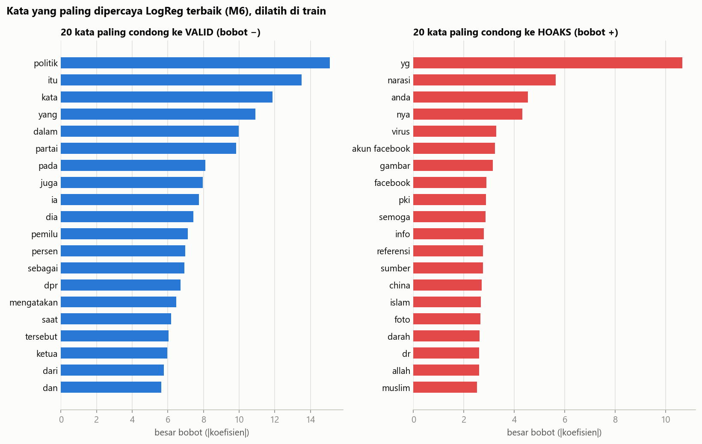

# Fake News Detection v1

Klasifikasi berita **hoaks vs valid** pakai ML klasik (TF-IDF + Logistic Regression, dengan Naive Bayes sebagai pembanding).

> 🚧 Masih dikerjakan. README lengkap diisi di M10.

## Dataset

- **Sumber:** Kaggle, _TODO: link halaman dataset_
- **Lisensi:** _TODO: cek di halaman Kaggle_
- **Bahasa:** Indonesia
- **Isi:** 4 file hasil scraping (folder `Cleaned/`)

| Sumber | Label | Kolom teks yang dipakai | Jumlah (setelah dibersihkan) |
|---|---|---|---|
| CNN Indonesia | valid (0) | `FullText` | 9.630 |
| Kompas | valid (0) | `FullText` | 4.723 |
| Tempo | valid (0) | `FullText` | 6.592 |
| Turnbackhoax | hoaks (1) | `Narasi` | 6.121 |
| **Total** | | | **27.066** (77,4% valid / 22,6% hoaks) |

**Pembersihan yang dilakukan** (detail di `notebooks/01_eda.ipynb`):
- Hoaks pakai kolom `Narasi` (isi hoaks yang beredar), bukan `FullText` (artikel bantahan pemeriksa fakta). `Narasi` dipotong di pembatas `===` / `Penjelasan:` supaya penjelasan pemeriksa fakta tidak ikut.
- Hanya artikel Turnbackhoax berjudul `[SALAH]`, `[HOAX]`, `[DISINFORMASI]`, dsb. Yang berjudul `[BENAR]`, `[KLARIFIKASI]`, `[BERITA]`, dll. dibuang (1.158 baris) karena bukan hoaks.
- Teks kosong / kurang dari 3 kata dibuang.

**Keterbatasan:** label ditentukan dari **sumber** (portal berita = valid, unggahan medsos yang dicek Turnbackhoax = hoaks). Akibatnya ada banyak "jejak sumber": dateline media, sisa scraping, perbedaan panjang teks (median 312 vs 28 kata), dan gaya bahasa formal vs informal. Lihat bagian Audit kebocoran (M7).

## Evaluasi di val set (M5)





| Model | Precision hoaks | Recall hoaks | F1 hoaks | ROC-AUC | FP (valid dituduh hoaks) | FN (hoaks lolos) |
|---|---|---|---|---|---|---|
| Dummy | 0,000 | 0,000 | 0,000 | 0,500 | 0 | 916 |
| TF-IDF + Naive Bayes | 0,997 | 0,346 | 0,514 | 0,997 | 1 | 599 |
| TF-IDF + LogReg | 0,986 | 0,965 | 0,975 | 0,998 | 13 | 32 |

Val set: 3.142 valid, 916 hoaks. Ambang keputusan 0,5.

**Catatan Naive Bayes:** ROC-AUC-nya hampir sama dengan LogReg (0,997), artinya NB sebenarnya bisa *mengurutkan* hoaks di atas valid dengan baik. Tapi peluang yang dia keluarkan terlalu kecil, jadi di ambang 0,5 dua pertiga hoaks lolos. Masalahnya ada di **ambang/kalibrasi**, bukan kemampuan membedakan. Ini akan diuji di M6 (nilai `alpha` lebih kecil).

### Mana yang lebih berbahaya: hoaks lolos (FN) atau berita asli dituduh hoaks (FP)?

Jawabannya tergantung **model ini dipakai untuk apa**.

| Skenario pemakaian | Kesalahan yang lebih mahal | Metrik prioritas |
|---|---|---|
| **A. Alat bantu penyaring untuk pemeriksa fakta manusia**: model menandai konten yang *perlu dicek*, keputusan akhir tetap di manusia | **FN**. Hoaks yang lolos nggak akan pernah dicek dan terus menyebar. FP cuma bikin pemeriksa buang beberapa menit | **Recall hoaks**, dengan syarat precision tetap wajar |
| **B. Pelabelan otomatis ke publik**: model langsung memberi cap "HOAKS" tanpa dicek manusia | **FP**. Berita asli yang dicap hoaks merusak kepercayaan ke media dan ke alat ini sendiri, dan bisa jadi bentuk sensor | **Precision hoaks** |

**Keputusan untuk project ini: skenario A, prioritas recall hoaks** (dengan F1 sebagai pembanding keseluruhan). Alasannya:
1. Model ini mendeteksi **gaya bahasa**, bukan **kebenaran fakta** (lihat Keterbatasan dan M7). Model seperti ini **tidak layak** memberi cap otomatis ke publik, jadi skenario B memang bukan pilihan.
2. Di skenario A, satu hoaks yang lolos (FN) bisa menyebar ke ribuan orang, sedangkan satu FP cuma menambah satu item di antrean pemeriksa.

Artinya, waktu memilih model di M6–M8, kita lihat **recall hoaks** dulu, dan precision dijaga jangan sampai anjlok (patokan kasar: ≥ 0,90). Untuk LogReg saat ini: dari 916 hoaks di val, **32 lolos** (recall 96,5%), dan **13 berita asli** ikut tertandai (precision 98,6%).

> ⚠️ Angka setinggi ini **belum tentu** berarti model paham hoaks. Lihat temuan EDA soal jejak sumber; ini diaudit di M7.

## Audit "model nyontek" (M7) ⭐

Model yang diaudit: LogReg terbaik dari M6 (C=10, ngram 1–2, min_df=5, tanpa stopword removal), val F1 0,986.



### 1. Kata yang paling dipercaya model

| Kategori | Condong hoaks (+) | Condong valid (−) | Penilaian |
|---|---|---|---|
| **Gaya bahasa** | yg, anda, nya, semoga, info, dr | kata, mengatakan, ia, dia, tersebut | Ciri **genre** (pesan berantai vs tulisan wartawan), bukan ciri benar/salah |
| **Topik** | virus, pki, china, islam, allah, muslim, darah | politik, partai, pemilu, dpr, ketua, persen | **Bias topik dataset**: berita valid didominasi politik 2018–2023, hoaks banyak bertema agama, kesehatan, komunisme |
| **Sisa tulisan pemeriksa fakta** | narasi, referensi, sumber, gambar, foto, akun facebook | – | ❌ **Jejak sumber yang lolos dari M3**, mis. "Narasi dalam gambar:", "REFERENSI:", "Sumber hasut:", "diposting akun Facebook X" |
| **Kata fungsi** | – | itu, yang, dalam, pada, juga, dari, dan | Ciri tulisan formal & panjang |

Hampir **tidak ada** kata yang menunjukkan model memahami *isi klaim*. Model belajar membedakan **unggahan medsos** dari **artikel portal berita**.

⚠️ **Risiko bias:** kata *islam*, *allah*, *muslim*, *china* berbobot positif (condong hoaks). Kalau model dipakai sungguhan, konten keagamaan atau tentang etnis tertentu berisiko lebih sering ditandai hoaks, padahal penyebabnya cuma komposisi topik di dataset.

### 2. Eksperimen jejak sumber & uji shortcut panjang (di val)

| Model | Accuracy | Precision | Recall | F1 | ROC-AUC |
|---|---|---|---|---|---|
| Dummy (tebak "valid" terus) | 0,774 | 0 | 0 | 0 | 0,500 |
| **Cuma tahu panjang teks** (1 fitur: log jumlah kata) | **0,970** | 0,976 | 0,889 | **0,930** | 0,975 |
| LogReg terbaik, jejak **dibuang** (model utama) | 0,994 | 0,994 | 0,977 | 0,986 | 0,999 |
| LogReg terbaik, jejak **tidak dibuang** | 0,994 | 0,995 | 0,980 | 0,987 | 0,999 |

- **Membuang jejak sumber hampir tidak mengubah skor** (F1 0,987 → 0,986). Bukan karena jejaknya nggak berbahaya, tapi karena model punya **banyak shortcut lain** yang sama kuatnya. Begitu satu ditutup, dia pakai yang lain.
- **Model yang cuma tahu panjang teks**, tanpa membaca satu kata pun, sudah dapat **akurasi 97% dan F1 0,93**. Artinya sebagian besar "kepintaran" model berasal dari fakta bahwa hoaks di dataset ini pendek (median ~24 kata) dan berita valid panjang (~300 kata). Membaca isi teks cuma menambah F1 dari 0,93 ke 0,99.

### 3. Kesimpulan audit

Skor 98–99% **tidak** berarti model bisa mendeteksi hoaks di dunia nyata. Model ini mendeteksi **"apakah teks ini terlihat seperti unggahan medsos atau seperti artikel berita panjang tentang politik"**. Hoaks yang ditulis rapi ala berita akan lolos (lihat error analysis), dan berita asli yang pendek/non-politik bisa dituduh hoaks.

## Error analysis (M7)

Semua prediksi salah model utama di val: **21 FN** (hoaks lolos) dan **5 FP** (valid dituduh hoaks). Daftar lengkap: `reports/m7/kesalahan_val.csv`. Median panjang teks yang salah ditebak: **264 kata**, padahal median hoaks di val cuma 24 kata.

**Hoaks yang lolos (21 FN):** hampir semuanya hoaks yang **panjang dan bergaya formal**

| Pola | Jumlah | Contoh |
|---|---|---|
| Opini/narasi politik panjang | 6 | skandal petinggi partai, "agen CIA" soal capres, pembelian helikopter |
| Hoaks berformat artikel berita dari situs abal-abal (pakai dateline/nama media palsu) | 5 | "PETROKSI – Komisi Pemilihan Umum…", "RumahNKRI – …", "ASATUNEWS – …" |
| Klaim "ilmiah" atau atas nama tokoh/pakar | 5 | "Harvard University menemukan…", surat dari "Prof. Dr. …", astronot mualaf |
| Dokumen/surat/pengumuman resmi palsu | 3 | surat tugas KPK, surat rekomendasi partai, razia STNK |
| **Data kotor**: teksnya ternyata tulisan pemeriksa fakta, bukan hoaksnya | 2 | "Penjelasan Lengkap: Beredar sebuah video…" (pembatas ini belum ditangkap regex M1/M3) |

**Berita valid yang dituduh hoaks (5 FP):**

| Pola | Jumlah | Contoh |
|---|---|---|
| Berita non-politik (hiburan) yang memakai kata "hoaks-ish" | 2 | rekomendasi film "…menjadi **referensi** tontonan **Anda**", lagu Coldplay |
| Topik yang sering jadi bahan hoaks | 2 | survei penolakan vaksin Covid-19, pengumuman cuti bersama |
| Berita pendek | 1 | kabar duka 60 kata |

**Polanya konsisten dengan audit:** model gagal tepat di kasus yang **tidak cocok dengan shortcut-nya**, yaitu hoaks yang panjang & formal, dan berita yang pendek atau non-politik. Sayangnya, hoaks yang ditulis meniru berita itulah yang paling berbahaya di dunia nyata.

## Cara menjalankan

```bash
python -m venv .venv
.venv\Scripts\activate        # Windows
pip install -r requirements.txt
```
